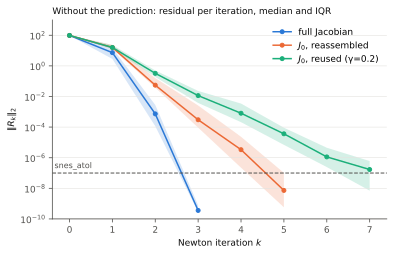
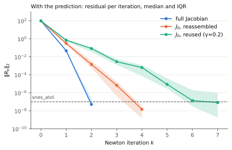
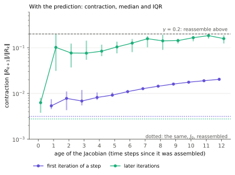
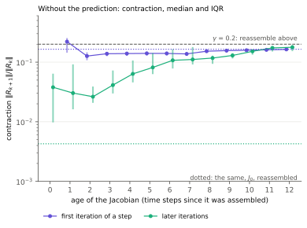
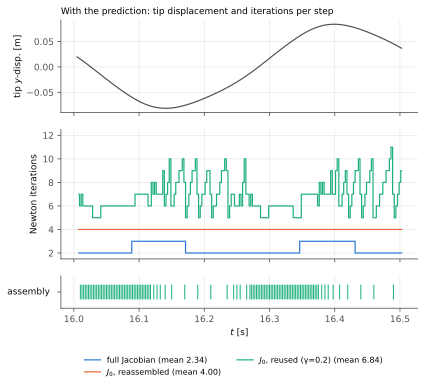
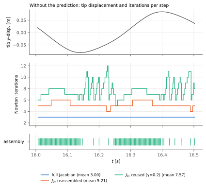

# Newton convergence of the FSI2 solvers

How the approximate Jacobian, its reuse and a prediction of the displacements affect the nonlinear
convergence of the FSI2 solvers, measured with the Newton logs of `xfsi_solver.tools.newton_log`.
Branch `newton-convergence-log`, PR 14 into `restricted`. The history of the work, with the
intermediate results this report supersedes, is in `implementation-log.md`.

## Setup

### Solvers

All three solvers solve the FSI2 benchmark in monolithic ALE form, with restricted test functions,
the same elements and a biharmonic mesh motion in mixed form (displacement u and auxiliary z), and
reach the same discrete solution. They differ in the Jacobian and in which unknowns Newton's method
sees.

- **`fsi2_biharmonic_fulljacobian`** implements the variational formulation with restricted test
  functions, as `docs/restricted-iterative-solver.md` sets it out. The displacement u is a single
  continuous field, and v is one velocity shared by fluid and solid. The displacement test
  functions on the interface have no fluid part, so the interface rows of the u equation hold only
  the solid kinematic relation (u - u_old) / dt = θ v + (1 - θ) v_old, and the mesh motion acts on
  the fluid-interior displacement only. The solver takes (u, v, p, z) as unknowns, with the solid
  stress in terms of u, and uses the exact Jacobian of this restricted residual. That Jacobian
  includes the replaced interface rows and the derivatives of the fluid equations with respect to
  the mesh displacement (the fluid ALE derivatives). Every Newton iteration assembles it and
  factorizes the whole coupled system with MUMPS. It is the reference for what Newton's method can
  do on this problem.
- **`fsi2_biharmonic_mixed`** solves the same restricted formulation, for the same unknowns, with
  the approximate Jacobian J_0. Only the Jacobian differs; the residual, and so the solution, does
  not. The
  solid stress is written in terms of v through the kinematic relation,
  u_s = u_s_old + dt (θ v + (1 - θ) v_old), and J_0 leaves out the fluid ALE derivatives. J_0 is
  then block lower triangular in (v, p), u_s and the mesh motion (z, u), and each Newton step is
  solved block by block. The mesh motion block is constant, so it is factorized once for the whole
  run; only the (v, p) block K_c is refactorized when J_0 is assembled (`direct_k_c_solve=True`).
  With `gamma_reassemble`, J_0 is also reused across iterations and time steps.
- **`fsi2_simplified`** is equivalent to `fsi2_biharmonic_mixed`, in a different implementation.
  Newton's method only sees (v, p) and the Jacobian K_c. The displacements are not unknowns: after
  each linear solve, a hook sets u_s from the kinematic relation and the interface values of the
  fluid displacement u_f the same way, and solves the mesh motion for u_f. This is what the block
  solve of `fsi2_biharmonic_mixed` does with J_0, since the displacement rows are linear and solved
  exactly in every iteration, so without the prediction both take the same Newton iterates (the
  rows of the results table agree). The smaller system makes it 15 to 21% faster. Only this
  solver, and its 3D version `threeDfsi_simplified`, has the displacement prediction
  (`predict_displacements`, the default): before each Newton solve, it sets
  u_s = u_s_old + dt v_old and the same on the interface for u_f, and solves the mesh motion.

### Runs

All runs solve the FSI2 benchmark on `mesh_sec` over 200 time steps of dt = 0.0025 from
t = 16.0025, with the beam in its periodic oscillation (about one period). They start from the
`fsi2_simplified` checkpoint at t = 16.0, advanced by one step of `fsi2_biharmonic_mixed` so that
the state holds z for the full-Jacobian solver. All linear solves are direct (MUMPS), the SNES
tolerances are `snes_atol` = 1e-7 and `snes_rtol` = 1e-12, and every run uses 5 MPI ranks.

| run | solver and options |
|---|---|
| full Jacobian | `fsi2_biharmonic_fulljacobian` |
| mixed, reassembled | `fsi2_biharmonic_mixed`, `direct_k_c_solve=True`, `gamma_reassemble=None` |
| mixed, reused | `fsi2_biharmonic_mixed`, `direct_k_c_solve=True`, `gamma_reassemble=0.2` |
| simplified, reassembled | `fsi2_simplified`, `predict_displacements=False`, `gamma_reassemble=None` |
| simplified, reused | `fsi2_simplified`, `predict_displacements=False`, `gamma_reassemble=0.2` |
| simplified, predicted, reassembled | `fsi2_simplified`, `gamma_reassemble=None` |
| simplified, predicted, reused | `fsi2_simplified` with its defaults (`predict_displacements=True`, `gamma_reassemble=0.2`) |

With reuse, J_0 is reassembled when the last Newton iteration reduced the residual norm by less
than a factor γ, and is otherwise kept, also across time steps. `gamma_reassemble=None` reassembles
it in every iteration.

The first time step of every run is left out, since it starts from the state of another solver.
The times are from running the configurations one at a time on the 32-core workstation, except the
full Jacobian, whose run was disturbed by other work on the machine and is timed by a 60-step check
run alone (see Caveats). "Rate k→k+1" is the median over the steps of ||R_(k+1)|| / ||R_k||.

## Findings

1. **The approximate Jacobian costs two iterations per step but halves the time.** The full
   Jacobian converges quadratically, in 3 iterations in every step. J_0 converges linearly, gaining
   2.2 to 2.4 orders of magnitude per iteration, in 5 to 6 iterations. An iteration with J_0 costs a
   quarter of one with the full Jacobian, so a step takes 0.54 s against 1.15 s.
2. **Reusing J_0 cuts the time per step by another factor 2.7**, to 0.20 s, although it takes 7.6
   iterations per step instead of 5.2. An iteration that reuses J_0 costs a fifth of one that
   assembles and factorizes it, and only 126 of 1506 iterations assemble.
3. **Predicting the displacements removes the slow first iteration.** The first iteration then
   contracts by 3e-3 instead of 0.16. Without reuse, every step converges in exactly 4 iterations
   instead of 5.2 (27% less time); with reuse, in 6.8 instead of 7.6 (11% less time). The saving
   grows with the velocity of the solid, which is large in FSI2; with small deformations per step
   it is much smaller (see the note at the end of Iterations over the period).
4. **`fsi2_simplified` is the fastest solver.** Without the prediction it takes the same iterations
   as `fsi2_biharmonic_mixed`, at 15 to 21% less time per step. With its defaults it takes 0.153 s
   per step, 7.5 times less than the full Jacobian.
5. **The reuse test is right to reassemble often in part of the period.** For about 60% of the
   period, a J_0 from the step before already contracts the later iterations by more than γ, so the
   run reassembles in almost every step there; in the rest, J_0 is kept for up to 12 steps.

## Results

| run | its/step | max its | assemblies | time/step (s) | rate 0→1 | 1→2 | 2→3 | 3→4 |
|---|---:|---:|---:|---:|---:|---:|---:|---:|
| full Jacobian | 3.00 | 3 | 597 | 1.145 | 7.6e-2 | 1.0e-4 | 9.0e-7 | |
| mixed, reassembled | 5.21 | 6 | 1036 | 0.543 | 1.6e-1 | 3.7e-3 | 6.8e-3 | 6.9e-3 |
| mixed, reused | 7.57 | 12 | 126 | 0.203 | 1.6e-1 | 1.5e-2 | 3.1e-2 | 6.6e-2 |
| simplified, reassembled | 5.21 | 6 | 1036 | 0.431 | 1.6e-1 | 3.7e-3 | 6.8e-3 | 6.9e-3 |
| simplified, reused | 7.57 | 12 | 126 | 0.172 | 1.6e-1 | 1.5e-2 | 3.1e-2 | 6.6e-2 |
| simplified, predicted, reassembled | 4.00 | 4 | 796 | 0.315 | 3.2e-3 | 5.0e-3 | 3.3e-3 | 2.1e-3 |
| simplified, predicted, reused | 6.84 | 11 | 109 | 0.153 | 7.2e-3 | 8.5e-2 | 4.3e-2 | 1.4e-1 |

All runs reach the same states: their QoIs agree to 4e-8 relative.

The figures show each comparison twice, side by side on the same axes: without the prediction,
where the J_0 runs are those of `fsi2_biharmonic_mixed` (`fsi2_simplified` takes the same
iterates), and with it, where they are those of `fsi2_simplified`. The full Jacobian has no
prediction and is shown in both as the reference.

## Residual per iteration

<p>


</p>

**Full and approximate Jacobian** (left). The median residual drops from about 1e2 by a factor 13
(full Jacobian) or 6 (J_0) in the first iteration: the initial guess, the state of the previous
step, is far from the solution, and the first step is not yet in the region of quadratic
convergence. After that, the full Jacobian gains 4 and then 6 orders of magnitude, and reaches
`snes_atol` in the third iteration in every step. J_0 gains 2.2 to 2.4 orders per iteration and
stops after 5 (71% of the steps), 6 (25%) or 4 iterations (4%), depending on where the last
iterates land relative to `snes_atol`. The medians at the last iterations are over the steps that
have not converged yet, so they lie above the band of the whole run.

The residual is almost entirely in the v block, the momentum equations of fluid and solid. Over the
iterations after the first, the median share of the other blocks in ||R|| is 5e-5 (p), 7e-7 (u)
and 3e-12 (z): the mesh motion and the kinematic rows are linear and solved exactly in every
iteration, so the per-block norms add little here.

**The prediction** (right) changes the first iteration. The solid stress is written in terms of v,
so the solid part of the residual of the initial guess is consistent already. What lags is the
fluid displacement u_f: in the initial guess it is that of the previous step, so the mesh velocity
(u_f - u_f_old) / dt in the residual vanishes, and the fluid sees the old geometry. J_0 is the
derivative with respect to (v, p) at fixed displacements, so the first Newton step does not see
that the update after it moves the fluid mesh by the displacement of a whole time step. With the
prediction, the residual of the initial guess hardly changes (median 97 against 98), but the first
iteration reduces it to 0.3 instead of 16 (J_0 reassembled): after the first linear solve, the mesh
only moves by dt θ (v_1 - v_old). Without reuse, every step then converges in exactly 4
iterations, at a contraction of 2e-3 to 5e-3 per iteration throughout. With reuse, the first
iteration does most of the work of the step, down to ||R_1|| ≈ 0.7, and the later ones contract
at the rate of the aged J_0.

## Contraction with a reused J_0

<p>


</p>

The age of a reused Jacobian is counted in time steps since it was assembled. The dotted lines are
the same medians with J_0 reassembled in every iteration.

**With the prediction** (left), the first iteration of a step contracts by 5e-3 to 2e-2, growing
with the age of J_0, so its rate measures the Jacobian like those of the later iterations do. The
later iterations with a J_0 from an earlier step contract by 0.08 to 0.18, so after the first
iteration the step still needs about 6 more. The prediction therefore saves fewer iterations with
reuse (0.7 per step) than without (1.2).

**Without the prediction** (right), the later iterations of a step contract by 3e-2 to 4e-2 with a
J_0 assembled in the current step, by 0.1 after 6 steps and by 0.18 after 11 to 12 steps, where
they reach γ and trigger the next assembly. A J_0 reassembled in every iteration contracts by 4e-3,
so even an assembly in the current step gives a 10 times worse Jacobian: it is assembled at the
first iterate of the step, far from the solution. The first iteration of a step contracts by 0.13
to 0.17 whatever the age of J_0, about as much as with a fresh J_0 (0.165): its rate is set by the
change of the solution over the time step, not by the Jacobian.

An option that left the first iteration out of the reuse test (`skip_first_reuse_test`) was tried
and removed again. Without the prediction, the assemblies the first-iteration test triggered just
moved to the fourth iterate of the same steps, for 2% fewer iterations. With the prediction, the
first iteration contracts by far less than γ, so the option changed nothing.

## Iterations over the period

<p>


</p>

Over the period, the runs with reuse alternate between two phases, with and without the
prediction:

- From about 0.1 s after a turning point of the tip, through its zero crossing, to the next turning
  point (t in 16.0 to 16.14 and 16.25 to 16.40), J_0 is reassembled in almost every step, and a step
  takes 5 to 8 iterations. Without the prediction, the first iteration contracts by 0.23 in the
  median, more than γ, and triggers 74 of the 126 assemblies. A J_0 from the step before would not
  last much longer anyway: it contracts 30% of the later iterations by more than γ (median 0.06).
  With the prediction, the later iterations trigger the assemblies instead.
- In the 0.1 s after a turning point (16.14 to 16.25 and 16.40 to 16.50), a J_0 from the step
  before contracts the later iterations by 0.014 (without the prediction), so J_0 is kept for up to
  12 steps, and the steps take 6 to 12 iterations as it ages.

The full Jacobian shows the same phases in its first iteration (0.14 against 0.03), so they come
from the solution, not from J_0. Without reuse, the prediction makes every step take 4 iterations,
against 4 to 6 without it.

**Note: the saving of the prediction depends on how fast the solid moves.** The prediction removes
the error of a mesh that lags by dt v, so it only pays off when the solid moves noticeably in a
time step. In FSI2 the tip moves at 0.3 to 1.1 m/s (up to 2.6 mm per step), and without the
prediction the first iteration contracts more the faster it moves (correlation 0.98 with the tip
speed). Split into thirds by tip speed:

| tip speed (m/s) | rate 0→1, off → on | its/step reassembled, off → on | its/step reused, off → on |
|---|---|---|---|
| 0.31 to 0.54 | 0.12 → 4e-3 | 5.00 → 4.00 | 7.63 → 7.52 |
| 0.54 to 0.86 | 0.17 → 3e-3 | 5.20 → 4.00 | 7.83 → 7.02 |
| 0.86 to 1.06 | 0.25 → 3e-3 | 5.42 → 4.00 | 7.22 → 5.96 |

With reuse, the prediction saves almost nothing in the slowest third and 1.3 iterations per step in
the fastest. The aneurysm model of aneurism-fsi (`threeDfsi_simplified`, 10 steps of dt = 1e-4 at
full load, 8 ranks, Jacobian reuse), whose wall moves very little per step, shows the same: the
prediction lowers the first contraction only from 0.04–0.06 to 0.03–0.04 and saves 0 to 2 of 34 to
37 Newton iterations. The numbers of this report are for the large deformations of FSI2, which is
what the benchmark is for; with small deformations the prediction is cheap and harmless but does
not do much.

## Cost


An iteration with the full Jacobian assembles it and factorizes the whole coupled system (0.38 s).
An iteration with J_0 assembles it and refactorizes only K_c, the (v, p) block, since the
factorization of the mesh motion block is kept for the whole run (0.10 s in
`fsi2_biharmonic_mixed`, 0.08 s in `fsi2_simplified`). An iteration that reuses J_0 only solves
with the factorizations, updates the displacements and assembles the residual (0.020 s and
0.017 s). The time per step follows from these: for J_0 with reuse, 0.63 assemblies × 0.106 s +
6.9 reused iterations × 0.020 s = 0.206 s, against the measured 0.203 s. An assembly costs about
as much as 4 reused iterations.

An iteration costs the same with and without the prediction, which adds one mesh motion solve per
step with the kept factorization, so the prediction saves exactly its share of iterations.

## Caveats

- One window of 200 steps, about one period, from one state, on one mesh. The phase pattern
  repeats in both half periods, but longer runs would show how stable the numbers are.
- The full-Jacobian run of the timing batch was 18% slower than in an earlier batch, evenly over
  the whole run, while every other run was 2 to 13% faster alone. A 60-step check run alone right
  after took 1.145 s per step over steps 2 to 60, against 1.163 s in the earlier batch, so the run
  was slowed down by other work on the machine; the tables use the check.
- Times from runs that shared the machine compare poorly between batches: an earlier version of
  this report gave 19% and 31% for the savings of the prediction from such a comparison.
- The values in the logs have 7 significant digits, enough for the rates.

## Next steps

- A γ sweep with the prediction (for example 0.05, 0.1, 0.3, 0.5) on the same window. With the
  prediction, the later iterations with a reused J_0 contract by about 0.1, so a smaller γ may pay
  off at a cost of 4 reused iterations per assembly.
- Measure the prediction in `threeDfsi_simplified` on a case with larger deformations. On the
  aneurysm model, with its small wall motion, it saves almost nothing (see the note at the end of
  Iterations over the period).
- The best configuration over a longer window.

## Reproducing

The runs called each `solve()` with
`initial_state_dir=output/newton_convergence/init_mixed/checkpoints`, `T = t0 + 200 dt`,
`dt_val=0.0025`, `mesh_path=data/meshes/fsi2/mesh_sec.xdmf`,
`newton_log_path=output/newton_convergence_rerun/<run>/<run>_newton.txt` and the options of the
setup table, on 5 ranks, one at a time. The figures are made by

```bash
python notes/newton-convergence/make_figures.py
```

from those logs and from the 60-step full-Jacobian check in `output/newton_convergence_check/`.
`python -m xfsi_solver.scripts.plot_newton_logs` makes the standard figure set and the summary
table for any set of runs.
