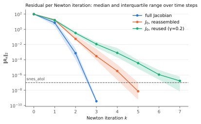
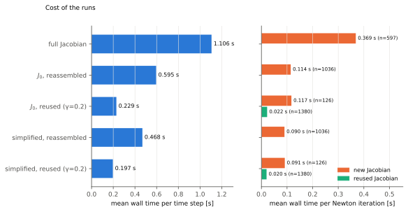
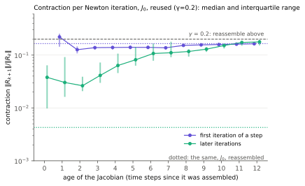
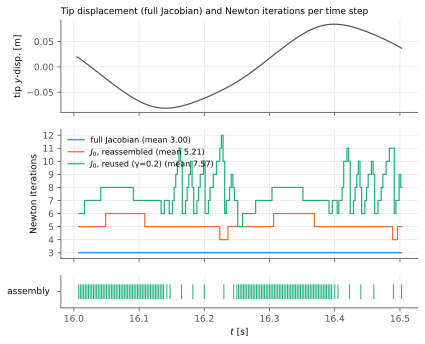

# Newton convergence of the FSI2 solvers: first comparison

Newton logs (`xfsi_solver.tools.newton_log`) of five FSI2 runs on `mesh_sec`, over 200 time steps
of dt = 0.0025 from t = 16.0025, with the beam in its periodic oscillation. All linear solves are
direct. The setup and the code are described in `implementation-log.md`.

| run | solver | Jacobian | reuse |
|---|---|---|---|
| full Jacobian | `fsi2_biharmonic_fulljacobian` | full | none (assembled every iteration) |
| J_0, reassembled | `fsi2_biharmonic_mixed`, `direct_k_c_solve=True` | approximate J_0 | `gamma_reassemble=None` |
| J_0, reused (γ=0.2) | `fsi2_biharmonic_mixed`, `direct_k_c_solve=True` | approximate J_0 | `gamma_reassemble=0.2` (the default) |
| simplified, reassembled | `fsi2_simplified` | J_0 w.r.t. (v, p) | `gamma_reassemble=None` |
| simplified, reused (γ=0.2) | `fsi2_simplified` | J_0 w.r.t. (v, p) | `gamma_reassemble=0.2` |

The first time step of every run is left out, since the runs start from a state of the mixed
solver. Rates are medians over the time steps of ||R_(k+1)|| / ||R_k||.

| run | its/step | max its | assemblies | time/step (s) | rate 0→1 | 1→2 | 2→3 | 3→4 |
|---|---:|---:|---:|---:|---:|---:|---:|---:|
| full Jacobian | 3.00 | 3 | 597 | 1.106 | 7.6e-02 | 1.0e-04 | 9.0e-07 |  |
| J_0, reassembled | 5.21 | 6 | 1036 | 0.595 | 1.6e-01 | 3.7e-03 | 6.8e-03 | 6.9e-03 |
| J_0, reused (γ=0.2) | 7.57 | 12 | 126 | 0.229 | 1.6e-01 | 1.5e-02 | 3.1e-02 | 6.6e-02 |
| simplified, reassembled | 5.21 | 6 | 1036 | 0.468 | 1.6e-01 | 3.7e-03 | 6.8e-03 | 6.9e-03 |
| simplified, reused (γ=0.2) | 7.57 | 12 | 126 | 0.197 | 1.6e-01 | 1.5e-02 | 3.1e-02 | 6.6e-02 |

## Summary

1. **The approximate Jacobian costs two iterations per step but halves the time.** The full
   Jacobian converges quadratically, in 3 iterations in every step. J_0 converges linearly, with a
   contraction of about 5e-3 per iteration after the first, in 5 to 6 iterations. An iteration
   with J_0 costs a third of one with the full Jacobian, so a step takes 0.60 s against 1.11 s.
2. **Reusing J_0 cuts the time per step by another factor 2.6**, to 0.23 s, although it takes 7.6
   iterations per step instead of 5.2. An iteration that reuses J_0 costs 0.022 s, a fifth of
   one that assembles and factorizes it (0.117 s), and only 126 of 1506 iterations assemble.
3. **The reuse test at the first iteration of a step does not measure the Jacobian.** The first
   iteration contracts by 0.13 to 0.24 whether J_0 is fresh or 12 steps old, depending on the
   phase of the oscillation. With γ = 0.2 right inside that band, the run reassembles in almost
   every step for about 60% of the period and not at all for the rest, where the Jacobian ages
   to 12 steps and the step needs up to 12 iterations.
4. **`fsi2_simplified` takes the same Newton iterations as `fsi2_biharmonic_mixed`**, with the same
   iteration counts and the same assembly pattern in every step and residuals within 1 to 2%, at
   14 to 21% less time per step.

## Convergence per iteration



The median residual of all three runs drops from about 1e2 by a factor 6 to 13 in the first
iteration: the initial guess, the state of the previous step, is far from the solution, and
the first step is not in the region of quadratic convergence. After that, the full Jacobian
gains 4 and then 6 orders of magnitude, and reaches `snes_atol` = 1e-7 in the third iteration in
every step. J_0 gains 2.2 to 2.4 orders per iteration, a linear rate, and stops after 5 (71% of
the steps), 6 (25%) or 4 iterations (4%), depending on where the last iterates land relative to
`snes_atol`. With reuse, the rate after the
first iteration is 1.5e-2 to 7e-2 and gets worse with every iteration. The medians at the last
iterations are over the steps that have not yet converged, so they lie above the band of the
whole run.

The residual is almost entirely in the v block, the momentum equations of fluid and solid. Over
the iterations after the first, the median share of the other blocks in ||R|| is 5e-5 (p), 7e-7
(u) and 3e-12 (z), so the per-block norms add little here: the mesh motion and the kinematic
rows are linear and solved exactly in every iteration.

## Cost



An iteration with the full Jacobian assembles it and factorizes the whole coupled system with
MUMPS (0.37 s). An iteration with J_0 assembles J_0 and refactorizes only K_c, the (v, p) block,
since the factorization of the mesh motion block K_m is kept for the whole run (0.11 s). An
iteration that reuses J_0 only solves with the factorizations and assembles the residual
(0.022 s). The time per step of the reuse run follows from these: 0.63 assemblies × 0.117 s +
6.9 reused iterations × 0.022 s = 0.226 s, against the measured 0.229 s.

`fsi2_simplified` takes 21% less time per step than `fsi2_biharmonic_mixed` without reuse and 14%
less with it: its Newton system has only (v, p), and it updates the displacements outside Newton,
which saves most in the iterations that assemble (0.090 s against 0.114 s).

## Jacobian reuse



The contraction of the iterations after the first of a step grows with the age of the
Jacobian: from 3e-2 to 4e-2 with a Jacobian assembled in the current step, to 0.1 after 6 steps
and 0.18 after 11 to 12, where it reaches γ and triggers the next assembly. A fresh J_0 in
every iteration contracts by 4e-3 (dotted green line), so even an assembly in the current step
gives a Jacobian 10 times worse: it is assembled at the first iterate of the step, which is far
from the solution.

The first iteration of a step behaves differently. It contracts by 0.13 to 0.17, whatever the
age of the Jacobian, and by about the same as with a fresh J_0 in every iteration (0.165,
dotted violet line). Its contraction is set by the change of the solution over the time step,
not by the Jacobian. The exception is age 1, the first iteration after the Jacobian was
assembled in the step before, at 0.22. These are the steps that just reassembled because their
first iteration contracted by more than γ, and the following step tends to do the same.



Over time, this splits the period in two phases:

- From about 0.1 s after a turning point of the tip, through its zero crossing, to the next
  turning point (t in 16.0 to 16.14 and 16.25 to 16.40), the first iteration contracts by 0.23 in
  the median, more than γ, in 63 to 67% of the steps. The run then reassembles J_0 after the first
  iteration of almost every step (74 of the 126 assemblies are at that point), so its Jacobian is
  rarely more than one step old, and the step takes 5 to 8 iterations.
- In about 0.1 s after a turning point (16.14 to 16.25 and 16.40 to 16.50), the first iteration
  contracts by 0.14, below γ, in every step. The Jacobian is then kept for up to 12 steps, until
  the later iterations contract by more than γ, and the steps take 6 to 12 iterations.

The full Jacobian shows the same phases in its first iteration (0.14 against 0.03), which
confirms that they come from the solution, not from J_0.

## Caveats

- One window of 0.5 s, from one state, on one mesh. The phase pattern repeats in both half
  periods of the window, but longer runs would show how stable the numbers are.
- The five runs shared the 32-core workstation, 5 ranks each, so the times are relative and
  rough. The ratios between the runs should hold better than the absolute times.
- The first step of each run is left out, since the start state comes from another solver.
- All values are written with 7 significant digits, enough for the rates.

## Next steps

- Leave the first iteration of a step out of the reuse test, or give it its own threshold: its
  contraction is not a measure of the Jacobian, and with γ = 0.2 it triggers most of the
  assemblies. A run with that change would show whether the Jacobian can be kept through the
  whole period.
- A γ sweep (for example 0.05, 0.1, 0.3, 0.5) in `fsi2_simplified` on the same window, to see
  where the trade-off between iterations and assemblies is best. With the costs above, an
  assembly is worth about 4 reused iterations.
- Time the best configuration again alone on the machine, and over a longer window.

## Reproducing

The runs were made by a scratch driver that called each `solve()` with
`initial_state_dir=output/newton_convergence/init_mixed/checkpoints`, `T = t0 + 200 dt`,
`dt_val=0.0025`, `mesh_path=data/meshes/fsi2/mesh_sec.xdmf` and
`newton_log_path=output/newton_convergence/<run>/<run>_newton.txt`, on 5 ranks each. The figures
and the table were made with

```bash
R=output/newton_convergence
python -m xfsi_solver.scripts.plot_newton_logs notes/newton-convergence/plots \
    "full Jacobian=$R/fulljacobian" "J_0, reassembled=$R/mixed_none" "J_0, reused (γ=0.2)=$R/mixed_0.2" \
    -- "simplified, reassembled=$R/simplified_none" "simplified, reused (γ=0.2)=$R/simplified_0.2"
```

which writes PNG and SVG figures; only the SVGs are kept here.
