# Newton contraction under mesh refinement

Does the linear contraction of Newton's method with the approximate Jacobian J_0 break down when
the mesh is refined? The FSI2 window of `notes/newton-convergence/report.md`, one period of the
oscillating beam, is solved on three nested meshes of mesh size h, h/2 and h/4, from the same state.
A time step sweep and the spectral radius of the error iteration of J_0 then separate the effects of h
and dt (see Time step and spectral radius), and its dominant eigenvectors show which errors are slow
to remove (see The slow modes). The history of the work is in `implementation-log.md`.

## Findings

1. **The contraction of J_0 does not break down.** With J_0 reassembled in every iteration, the later
   iterations contract the residual by 3.6e-3, 4.2e-3 and 4.9e-3 (median) on the three meshes with
   the displacement prediction, and by 5.5e-3, 5.9e-3 and 6.5e-3 without it: 8 to 17% more per
   halving of h, roughly h^(-0.1) to h^(-0.2). A step takes 4.75, 4.97 and 5.07 iterations to a
   relative tolerance of 1e-11.
2. **The first iteration does not depend on h.** It contracts by 3.2e-3 with the prediction and by
   0.16 to 0.17 without it on every mesh.
3. **The growth with h is real, not an artefact of the norm.** The spectral radius of J_0^(-1) N,
   the asymptotic contraction without tolerances or norms, grows by 1.20 and 1.14 per halving of h
   (4.6e-3, 5.5e-3 and 6.3e-3 at dt = 0.0025), as the measured rates do. The ratio of successive
   Newton updates, which falls from 1.5e-2 to 1.2e-2 with the prediction (and grows from 6.4e-3 to
   9.2e-3 without it), is a poorer estimate over only 2 to 4 iterations.
4. **The full Jacobian stays quadratic.** It takes 3 iterations per step on every mesh, contracting
   by 4.7e-4 to 4.9e-4 and then by 3.5e-6 to 4.5e-6, so the problem itself does not get harder for
   Newton's method on finer meshes.
5. **With reuse, the cost per step does not grow.** J_0 with the prediction and reuse (gamma 0.2)
   takes 6.72, 6.27 and 6.23 iterations per step and assembles J_0 in 109, 110 and 110 of the 199
   steps. The default absolute `snes_atol` asks for a little less on a finer mesh, whose residual is
   smaller (median ||R_0|| 96, 49 and 25), so the counts fall slightly.
6. **J_0 with reuse is fragile to a disturbed state.** A state interpolated onto a finer mesh rings,
   hardly damped by theta = 0.5 + dt, and J_0 with reuse diverged within 7 to 15 steps on h/2 and
   h/4 (see Setup). This is about the transfer, not about the refinement, but it shows that a reused
   J_0 copes badly with high-frequency transients.
7. **A smaller time step helps the contraction only a little.** On h, the spectral radius falls from
   7.0e-3 to 4.6e-3, 3.9e-3 and 3.2e-3 as dt halves from 0.005 to 0.000625, roughly dt^0.36, and the
   measured contraction of the later iterations about as slowly. Only the first iteration with the
   prediction contracts in proportion to dt (9.6e-3 to 1.3e-3), so a step takes about 5 iterations
   at every dt.
8. **Refined in h and dt together, the contraction stays the same.** Over the first 0.04 s of the
   window, the spectral radius is 4.79e-3 at (h, 0.0025), 4.85e-3 at (h/2, 0.00125) and 4.74e-3 at
   (h/4, 0.000625), within 2% of each other at every sample time: the growth with h and the decrease
   with dt cancel, as the CFL number stays the same (see The CFL number). Refined in h alone, it is 6.4e-3 on h/4, and in dt alone, 3.4e-3 at dt = 0.000625.
   The measured contraction of the later iterations still grows along this line (5.6e-3, 6.3e-3,
   7.6e-3, from 1.16 to 1.59 times the spectral radius), but the first iteration, in proportion to
   dt, makes up for it: every step takes 5.00 iterations on all three.
9. **The two parts of the fluid ALE derivatives must be left out together.** Leaving out only the
   derivatives of the momentum residual gives a spectral radius of 1.1e-2 at dt = 0.0025 on h, only
   those of the continuity residual 7.2e-3, and both, as J_0 does, 4.6e-3: the two parts partly
   cancel, as if the geometry were frozen consistently in all the fluid equations. Each part alone
   falls with dt as slowly as both together.
10. **The measured contraction lies above the spectral radius.** Over the 2 to 4 iterations of a step,
    the measured rate is 1.2 to 2 times the spectral radius at dt = 0.0025 and below (about equal at
    0.005), most near the turning point of the tip,
    where the spectral radius falls earlier than the measured rate. The error iteration is far from
    normal, and its dominant eigenvalues are a complex pair, which makes the measured ratios alternate
    from one iteration to the next.
11. **The slowest errors live at the tip of the beam.** The dominant eigenvectors of J_0^(-1) N fall
    into two families (see The slow modes). The dominant complex pair is concentrated at the tip, with
    its peak at the lower tip corner, a re-entrant corner of the fluid. The real volume modes change
    the area of the beam and push a column of fluid out of the channel, whose inertia, an added mass of
    the channel, sets their channel-wide pressure.
12. **The growth with h comes from the corner singularity.** Only the tip pair grows with h (4.89e-3,
    5.77e-3 and 6.52e-3 at dt = 0.0025, as the spectral radius does), and it sharpens at the lower tip
    corner. The volume mode is converged in h (3.54e-3, 3.37e-3 and 3.47e-3). At that corner the flow
    is singular, and the state's largest |∇v| and |p| near it grow by 1.4 and 1.2 per halving.
13. **The two families explain the dependence on dt.** The volume modes fall about as dt^0.65 and
    dominate at dt = 0.005, as the real dominant eigenvalue there. The tip pair falls only about as
    dt^0.22 and dominates below. The added-mass explanation of the weak dependence on dt holds for the
    volume modes but not for the dominant tip pair, whose pressure does not scale like 1/dt.
14. **A few slow modes stand above a dense band.** Of the 30 dominant eigenvalues, the tip pair and
    three real modes stand apart; from 0.44 of the spectral radius on h and 0.39 on h/4 (at
    dt = 0.0025), the rest form a dense band of complex pairs that falls only slowly. Removing the tip
    pair alone would lower the spectral radius to 0.75 of its value on h and 0.56 on h/4, to about
    3.4e-3 on both, which ends its growth with h. Removing the three real modes too would lower it to
    the band. Neither saves an iteration per step at the tolerance of 1e-11: that would need the later
    iterations to contract about 4.6 times faster.
15. **The tip pair follows the CFL number, the volume mode dt.** The scheme has no CFL condition for
    stability, but at dt = 0.0025 the largest flow CFL number |v| dt / h is 0.88, 1.87 and 3.84 on h,
    h/2 and h/4. The tip pair depends on h and dt nearly only through it, about as its 0.22nd power,
    and the volume mode on dt alone. So at dt <= 0.0025 the spectral radius follows the CFL number,
    about as (dt/h)^0.25, which is why it stays flat along dt ∝ h.

## Setup

### Meshes

`create_mesh_FSI2.create_mesh(refinements=n)` splits the linear gmsh mesh uniformly n times before
making it second order, so the meshes are nested and the new nodes on the cylinder lie on the
circle. The current gmsh does not reproduce `mesh_sec` exactly (5851 cells against 5861), and
dolfinx cannot refine a quadratic mesh, so the whole family is regenerated:

| mesh | relative h | cells | nodes |
|---|---|---:|---:|
| `refinement/mesh_sec_ref0` | h | 5851 | 11929 |
| `refinement/mesh_sec_ref1` | h/2 | 23404 | 47262 |
| `refinement/mesh_sec_ref2` | h/4 | 93616 | 188140 |

### States

Every mesh starts from the state of the Newton convergence report, `fsi2_biharmonic_mixed` on
`mesh_sec` at t = 16.0025, interpolated onto it by `xfsi_solver.scripts.transfer_fsi2_checkpoint`
(u and v on the whole mesh, p and z on the fluid submesh). The interpolated state is not a discrete
solution on the new mesh, and with theta = 0.5 + dt the mismatch rings: on the h/2 and h/4 meshes,
the initial residual of a step grew to 5000 within 15 steps, against 97 on `mesh_sec`, and a reused
J_0 diverged. A transfer onto `mesh_sec` itself keeps it at 97, so the transfer loses no state. So
every mesh first takes 20 steps of backward Euler (theta = 1), which damp the transient, then one
period of 200 steps with the usual theta, both with J_0 reassembled in every iteration. The settled
state at t = 16.5525 starts the measurements. On h, the measured rates reproduce those of `mesh_sec`
in the Newton convergence report (3.2e-3, 5.0e-3 and 3.3e-3 for the first three iterations).

### Runs

Each run solves one period (200 steps of dt = 0.0025, t from 16.5525 to 17.0525) on each mesh:

| run | solver and options |
|---|---|
| J_0, predicted | `fsi2_simplified`, `gamma_reassemble=None`, `snes_rtol` 1e-11, `snes_atol` 1e-13 |
| J_0, not predicted | the same, `predict_displacements=False` |
| full Jacobian, predicted | `fsi2_biharmonic_fulljacobian_initialguess`, `snes_rtol` 1e-11, `snes_atol` 1e-13 |
| J_0, predicted, reused | `fsi2_simplified`, `gamma_reassemble=0.2`, default tolerances (`snes_atol` 1e-7) |

The tight relative tolerance keeps the iterations going well past the default absolute tolerance,
whose meaning changes with h: the l2 norm of the residual halves with each refinement (median
||R_0|| 96, 49 and 25), since each entry integrates over a smaller cell. Contraction ratios are
taken only between residuals above 1e-9 ||R_0||, clear of round-off. On h/2 and h/4, the residual of
the full Jacobian reaches round-off before 1e-11 ||R_0||, so most of its steps stop on PETSc's
default step tolerance (`snes_stol` 1e-8) after 3 iterations instead; `fsi2_simplified` sets
`snes_stol` to 0, and no J_0 run reached its limit of 14 iterations. The first step of every run is
left out of the figures; the tables are over all 200 steps. The runs on the three meshes ran on 2, 4
and 3 to 10 MPI ranks, partly side by side, so their times are not compared.

## Results

| run | mesh | its/step | rate 0→1 | 1→2 | later iterations (median, IQR) | update ratio |
|---|---|---:|---:|---:|---|---:|
| J_0, predicted | h | 4.75 | 3.2e-3 | 5.0e-3 | 3.6e-3 [2.1e-3, 6.2e-3] | 1.46e-2 |
| | h/2 | 4.97 | 3.2e-3 | 6.1e-3 | 4.2e-3 [2.4e-3, 7.1e-3] | 1.29e-2 |
| | h/4 | 5.07 | 3.1e-3 | 7.2e-3 | 4.9e-3 [2.9e-3, 8.2e-3] | 1.18e-2 |
| J_0, not predicted | h | 5.61 | 0.17 | 3.4e-3 | 5.5e-3 [2.6e-3, 9.1e-3] | 6.4e-3 |
| | h/2 | 5.92 | 0.16 | 4.0e-3 | 5.9e-3 [3.2e-3, 1.1e-2] | 8.2e-3 |
| | h/4 | 6.03 | 0.16 | 4.7e-3 | 6.5e-3 [3.7e-3, 1.2e-2] | 9.2e-3 |
| full Jacobian, predicted | h | 3.00 | 4.7e-4 | 4.5e-6 | | |
| | h/2 | 3.00 | 4.9e-4 | 4.3e-6 | | |
| | h/4 | 3.00 | 4.9e-4 | 3.5e-6 | | |

"Rate k→k+1" is the median of ||R_(k+1)|| / ||R_k|| over the steps, "later iterations" the median
over all iterations after the first, and "update ratio" the median of ||δx_(k+1)|| / ||δx_k|| over
the same iterations.

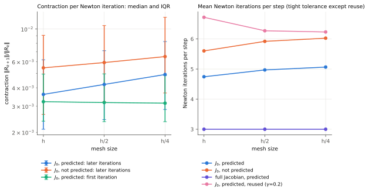

The contraction of the later iterations grows slowly with refinement, by a factor 1.17 per halving
with the prediction and 1.09 without it. The first iteration does not change. The iteration counts
follow: 0.3 to 0.4 more iterations per step from h to h/4 (4.75 to 5.07 with the prediction, 5.61
to 6.03 without it).

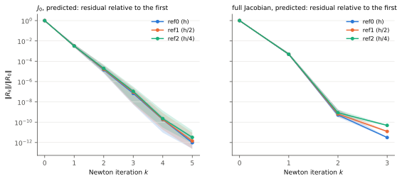

Relative to the residual of the initial guess, the histories of the three meshes lie on top of each
other for J_0, and for the full Jacobian up to its second iteration. Its third iteration reaches the
round-off floor, which lies higher on the finer meshes.

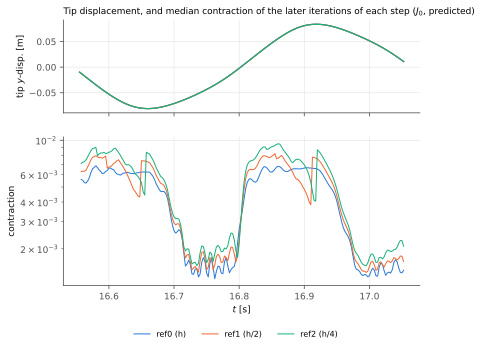

Over the period, the contraction of J_0 follows the phase of the oscillation in the same way on every
mesh: on h, about 6e-3 while the tip moves fast and about 1.5e-3 around the turning points. Each
halving of h raises it by about 20% in the fast phases (6.3e-3, 7.5e-3, 8.8e-3) and by about 10%
around the turning points (1.5e-3, 1.6e-3, 1.8e-3), so the growth with h is largest where the solid
moves fast and the neglected ALE derivatives, through the mesh velocity, matter most. The jumps of a
curve are steps where an iteration more or fewer changes which ratios enter its median.

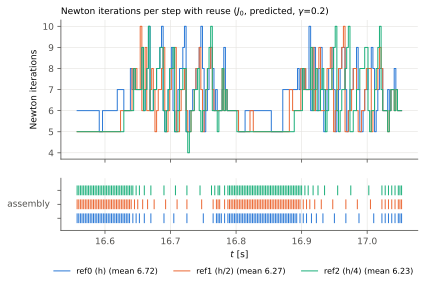

With reuse, the three meshes reassemble J_0 in the same phases and as often, and take the same
number of iterations per step up to the slightly looser absolute tolerance on the finer meshes.

## Time step and spectral radius

J_0 leaves out N, the derivatives of the fluid momentum and continuity residuals with respect to the
mesh displacement (the blocks F and D of eq. (1) of `docs/restricted-iterative-solver.md`), and
near the solution Newton's method with J_0 iterates the error as e_(k+1) = -J_0^(-1) N e_k. The
spectral radius of J_0^(-1) N is therefore the asymptotic contraction factor.
`fsi2_biharmonic_fulljacobian_initialguess` computes it with `spectral_every`, at the solution of a
step: it assembles J and N there, factorizes J_0 = J - N once with MUMPS, and finds the eigenvalues
of largest modulus by Krylov-Schur in SLEPc (`xfsi_solver.tools.spectral`). On the settled state
of h, it tracks the measured contraction of `fsi2_simplified`, at 0.6 to 0.8 times it over the first
steps.

The runs cover the first 0.12 s of the period of the refinement study (from the fast phase of the
tip to its turning point at t = 16.66), from the same settled states, on h at dt = 0.005, 0.0025,
0.00125 and 0.000625, on h/2 at dt = 0.0025 and 0.00125, and on h/4 at dt = 0.0025 and, over the
first 0.04 s only, at 0.000625. The spectral radius is sampled every 0.005 s, at the solution of the
full Jacobian with the prediction; the measured rates are those of J_0 with the prediction,
reassembled in every iteration, to a relative tolerance of 1e-11.

| mesh | dt | spectral radius (median, IQR) | measured, later iterations | measured, first iteration |
|---|---|---|---:|---:|
| h | 0.005 | 7.0e-3 [6.6e-3, 7.3e-3] | 6.6e-3 | 9.6e-3 |
| h | 0.0025 | 4.6e-3 [3.6e-3, 5.1e-3] | 5.8e-3 | 5.1e-3 |
| h | 0.00125 | 3.9e-3 [3.2e-3, 4.4e-3] | 5.1e-3 | 2.6e-3 |
| h | 0.000625 | 3.2e-3 [2.6e-3, 3.6e-3] | 4.4e-3 | 1.3e-3 |
| h/2 | 0.0025 | 5.5e-3 [4.6e-3, 6.1e-3] | 6.7e-3 | 5.1e-3 |
| h/2 | 0.00125 | 4.8e-3 [4.0e-3, 5.4e-3] | 6.7e-3 | 2.6e-3 |
| h/4 | 0.0025 | 6.3e-3 [5.3e-3, 7.0e-3] | 7.7e-3 | 5.0e-3 |
| h/4 | 0.000625 (first 0.04 s) | 4.7e-3 [4.4e-3, 5.2e-3] | 7.6e-3 | 8.0e-4 |

The measured rates are medians over the same window as the spectral radius, 0.12 s except on h/4 at
dt = 0.000625.

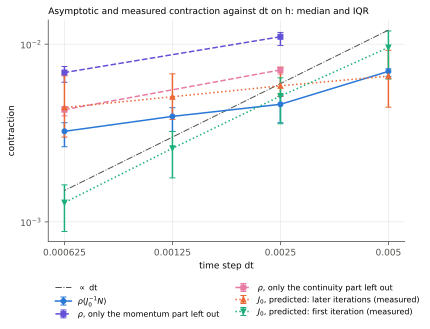

On h, the spectral radius falls with dt by a factor 1.53, then 1.17 and 1.21 per halving, roughly
dt^0.36, and the measured contraction of the later iterations by about 1.15 per halving. The first
iteration with the prediction contracts in proportion to dt: the prediction u_old + dt v_old is
off by about dt^2 a / 2, against a residual of the initial guess of order dt. With only the
momentum or only the continuity part left out, the spectral radius is larger (1.1e-2 and 7.2e-3 at
dt = 0.0025) and falls with dt about as slowly (by 1.59 and 1.67 from dt = 0.0025 to 0.000625,
against 1.42 for both).

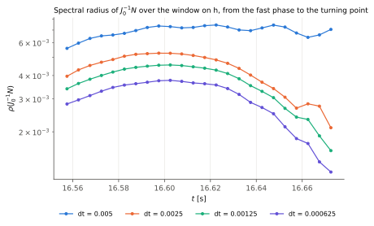

Over the window, the spectral radius at dt = 0.0025 and below keeps its shape from one time step to
the next, rising through the fast phase and falling toward the turning point, each curve about 1.2
times below the last. At dt = 0.005 it stays high through the turning point: there, the dominant
eigenvalue is real in every sample, while at the smaller time steps it is a complex pair in 83 to
100% of them, so at the largest time step another mode takes over, a volume mode (see The slow modes). The measured rate falls toward
the turning point later than the spectral radius and stays up to twice as large: over only 2 to 4
iterations, the ratio of residual norms of a far from normal error iteration is set by more than its
spectral radius.

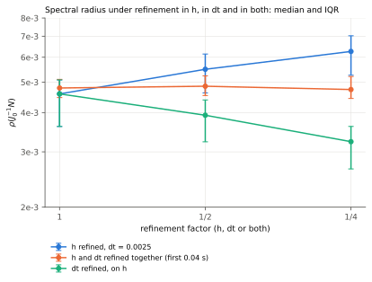

Refined in h at dt = 0.0025, the spectral radius grows by 1.20 and 1.14 per halving; refined in dt
on h, it falls by 1.17 and 1.21; refined in both, over the first 0.04 s of the window where all three
are run, it stays at 4.79e-3, 4.85e-3 and 4.74e-3. The measured rate of the later iterations grows
along the same line (5.6e-3, 6.3e-3 and 7.6e-3), so the transient of the error iteration, not its
asymptotic rate, grows with refinement; the first iteration contracts by 3.1e-3, 1.6e-3 and 8.0e-4,
and the steps take 5.00 iterations on all three.

## The slow modes

The eigenvectors of the dominant eigenvalues show which errors J_0 is slow to remove.
`fsi2_biharmonic_fulljacobian_initialguess` writes them with `spectral_vectors_dir`, and
`analyse_modes.py` measures them. The runs cover the first 0.04 s of the window from the settled
states, with the 4 dominant eigenpairs every 0.01 s, on h at the four time steps, on h/2 at
dt = 0.0025 and 0.00125, and on h/4 at 0.0025 and 0.000625; their eigenvalues agree with those of
the sweep at the same times to 1e-4.

N acts only on the displacement in the fluid, and J_0 extends the displacement from the interface
into the fluid by the mesh motion, so a mode is set by its interface displacement du_I: J_0^(-1) N
maps du_I to a response whose interface displacement is λ du_I. Each mode is scaled to
||du_I||_L2 = 1, with the complex phase that makes the real part of du_I largest. On the solid the
response keeps u = dt θ v, so the interface velocity is |dv_I| = 1/(dt θ), about 800 at
dt = 0.0025.

The modes fall into two families:

- **The tip pair**, the complex pair of largest modulus, lives at the tip of the beam. At
  dt = 0.0025 on h, 92% of |du_I|^2 lies on the last 10% of the beam and the tip, with a peak of some 40
  times the displacement along the beam at the lower tip corner, a re-entrant corner of the
  fluid. Its pressure has a core at that corner on top of a channel-wide field.
- **The volume modes**, real, change the area of the beam: at dt <= 0.0025, 88 to 97% of the
  integral of |du_I . n| is a net change of area (45 to 66% at dt = 0.005) (the beam's own motion, bending, hardly changes it). Their pressure is a
  channel-wide field, flat upstream of the beam, where the inflow velocity is fixed, and falling
  linearly to the outflow. It is the inertia of the fluid column that the change of area pushes out
  of the channel, about ρ_f L dv / dt over the 1.9 m from the beam to the outflow: an added mass,
  of the channel rather than of the beam.

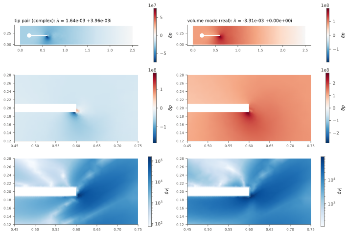

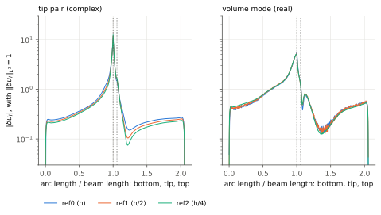

A third kind, real modes concentrated at single interface nodes along the beam, appears in some
samples below the dominant four but never dominates.

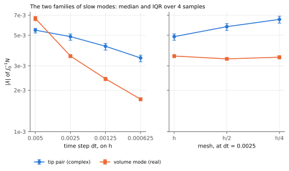

| mesh | dt | tip pair \|λ\| | volume mode \|λ\| | tip pair: solid velocity within 0.01 of a corner | tip pair: p dt / (ρ_f \|dv_I\|) |
|---|---|---:|---:|---:|---:|
| h | 0.005 | 5.45e-3 | 6.61e-3 | 25% | 0.45 |
| h | 0.0025 | 4.89e-3 | 3.54e-3 | 56% | 0.12 |
| h | 0.00125 | 4.16e-3 | 2.42e-3 | 80% | 0.025 |
| h | 0.000625 | 3.43e-3 | 1.72e-3 | 93% | 0.006 |
| h/2 | 0.0025 | 5.77e-3 | 3.37e-3 | 63% | 0.11 |
| h/2 | 0.00125 | 4.97e-3 | 2.45e-3 * | 86% | 0.021 |
| h/4 | 0.0025 | 6.52e-3 | 3.47e-3 | 67% | 0.10 |
| h/4 | 0.000625 | 4.89e-3 | 2.41e-3 * | 97% | 0.005 |

The medians are over the 4 samples; * a volume mode is among the dominant four in only 2 of them. The pressure column is the L2 norm of dp scaled by ρ_f |dv_I| / dt;
it would stay constant for an added-mass response.

**In dt**, the two families fall at different rates, which explains the shape of the spectral
radius. The volume modes fall about as dt^0.65 and the tip pair about as dt^0.22. At dt = 0.005 a
volume mode dominates, which is the real dominant eigenvalue of the sweep. Between 0.005 and 0.0025
it drops below the tip pair, which gives the first, larger drop of the spectral radius (1.53). Below
that, the slow tip pair dominates, which gives the later factors of 1.17 and 1.21. As dt falls, the
tip pair also concentrates further at the tip corners.

**The added-mass explanation holds only for the volume modes.** The earlier version of this
section ascribed the weak dependence on dt to the pressure answering an acceleration of the interface
like 1/dt. The volume modes do carry such a pressure, the inertia of the channel's fluid column, but
they fall with dt fast enough. The dominant tip pair does not: its pressure, scaled by ρ_f |dv_I| / dt,
falls from 0.45 to 0.006 as dt halves from 0.005 to 0.000625.

**In h**, only the tip pair grows: by 1.18 and 1.13 per halving at dt = 0.0025, as the spectral radius does over
the whole window (1.20 and 1.14), while the volume mode stays at 3.54e-3, 3.37e-3 and 3.47e-3 and its
interface displacement on the three meshes lies on top of each other. The growth comes
from the lower tip corner, where the flow is singular. In the settled state, the largest values within
0.01 of the corner grow with refinement, while at the upper tip corner (in the lee at this phase) and
at the beam-cylinder junction they stay flat:

| mesh | lower tip corner: max \|∇v\| | max \|p\| | upper tip corner: max \|∇v\| | junction: max \|∇v\| |
|---|---:|---:|---:|---:|
| h | 243 | 797 | 32.5 | 2.66 |
| h/2 | 357 | 957 | 31.4 | 3.12 |
| h/4 | 489 | 1165 | 34.4 | 3.33 |

A 270° corner of Stokes flow has ∇v and p ~ r^(-0.455), a factor 1.37 per halving of h. N carries the
state's ∇v and p as coefficients, so the finer the mesh resolves the singularity, the stronger N
couples the displacement at the corner. Along dt ∝ h, the tip pair keeps its modulus (4.89e-3 at
(h, 0.0025), 4.97e-3 at (h/2, 0.00125) and 4.89e-3 at (h/4, 0.000625)) while concentrating further at
the corner (56%, 86% and 97% of its solid velocity within 0.01 of a corner). This explains why the spectral radius stays flat along that line; The CFL number shows why the two
effects cancel.

### Below the dominant modes

The runs `modes30_*` compute the 30 dominant eigenvalues at the first two samples (t = 16.5625 and
16.5725), on h at dt = 0.0025 and 0.005, with the eigenvectors, and on h/4 at dt = 0.0025, without
them.

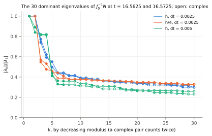

At dt = 0.0025 on h, the tip pair and three real modes stand above the rest. The real modes are, in
order:
- a volume mode at 0.74 to 0.77 of the largest, peaking at the lower tip corner, with a net change
  of area of 91% of the integral of |du_I . n|;
- a second volume mode at 0.59 to 0.62, peaking on the bottom side 0.025 before the tip, at 86 to
  88%;
- a mode at the upper tip corner at 0.50 to 0.55, its interface displacement on about four nodes.

From 0.44 down, the spectrum is a dense band of complex pairs, still at 0.30 at the 30th. Their
interface displacements peak on the bottom side, 0.04 to 0.06 before the tip, and spread over 10 to
60 nodes.

At dt = 0.005 the same kinds come in another order: the two volume modes (1 and 0.84 to 0.89), the
tip pair (0.81 to 0.82) and the upper-corner mode (0.41 to 0.44). The band follows from 0.33 to 0.36,
down to 0.23 at the 30th.

| mesh | dt | tip pair | the three real modes | top of the band | 30th |
|---|---|---:|---:|---:|---:|
| h | 0.0025 | 4.28e-3, 4.71e-3 | 3.31 to 2.13e-3, 3.49 to 2.59e-3 | 1.87e-3, 2.09e-3 | 1.29e-3, 1.40e-3 |
| h/4 | 0.0025 | 5.73e-3, 6.25e-3 | 3.14 to 2.63e-3, 3.56 to 2.82e-3 | 2.22e-3, 2.35e-3 | 1.88e-3, 2.04e-3 |
| h | 0.005 | 4.88e-3, 5.30e-3 | 5.95, 5.29, 2.60e-3; 6.51, 5.47, 2.68e-3 | 1.96e-3, 2.36e-3 | 1.38e-3, 1.69e-3 |

In h, only the tip pair separates from the rest. The next eigenvalue, the volume mode of the lower tip
corner, is the same on h and h/4 (about 3.3e-3 and 3.5e-3), so the tip pair leads it by 0.75 on h and
by 0.56 on h/4. The band rises by 1.1 to 1.2 from h to h/4 and flattens, as the finer mesh resolves more
of it. At h/4 the second sample has two more real eigenvalues at its top, at 0.44 and 0.41.

For the error iteration, the gap means the following:
- A correction of the tip pair alone, the first of the next steps, would lower the spectral radius at
  dt = 0.0025 to about 3.4e-3 on both meshes, the volume mode, and end its growth with h.
- Removing the tip pair and the three real modes would leave the top of the band, 2.0 to 2.4e-3. No
  correction of a few modes gets below it.

At the tolerance of 1e-11, neither saves an iteration. The steps take 5 iterations on h at
dt = 0.0025, the first gaining 2.3 decades and the later ones 2.2. A fourth iteration would suffice
only if the later ones gained 2.9 decades, contracting by 1.3e-3, about 4.6 times below the measured
5.8e-3. Even the band alone is above that.

## The CFL number

The scheme has no CFL condition for stability. The fluid and the solid are both implicit, with
θ = 0.5 + dt, and each step is solved to 1e-11 by Newton's method. The fluid is incompressible, so
there is no acoustic limit, and the mesh motion is elliptic and solved within the step. The monolithic
coupling also avoids the added-mass instability of partitioned schemes.

The CFL numbers still set the accuracy in time, and they turn out to set the tip pair. `cfl_numbers.py`
measures them in the settled states at dt = 0.0025 (t = 16.5625):
- the flow CFL number |v| dt / h on the fluid cells, with |v| at the cell midpoint, h the cell
  diameter and the mesh velocity left out;
- the elastic CFL numbers of the solid, c dt / h with the pressure and shear wave speeds
  c_p = 17.3 and c_s = 7.07 (ν_s = 0.4).

| mesh | smallest fluid h | \|v\| dt / h: max | 99th percentile | median | solid c_p dt / h | solid c_s dt / h |
|---|---:|---:|---:|---:|---:|---:|
| h | 4.1e-3 | 0.88 | 0.64 | 0.13 | 11 | 4.5 |
| h/2 | 2.0e-3 | 1.87 | 1.26 | 0.26 | 22 | 9.0 |
| h/4 | 1.0e-3 | 3.84 | 2.54 | 0.52 | 44 | 18 |

Refined in h at a fixed dt, the CFL number grows as 1/h. At dt = 0.0025 on h/4, the flow crosses up to
about four cells per step, so near the beam the error in time probably dominates the error in space.
The elastic waves of the solid are far from resolved on every mesh. They do not matter for the bending
of the beam, but θ = 0.5 + dt damps them only slightly, which may be why a disturbed state rings
(finding 6); this is not tested.

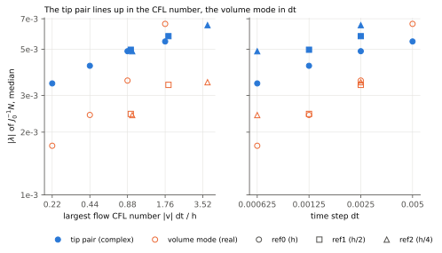

The tip pair depends on h and dt nearly only through the CFL number. Its modulus on h rises from
3.43e-3 to 5.45e-3 as the largest CFL number goes from 0.22 to 1.76, about as its 0.22nd power. At a
CFL number of about 0.9, the three meshes give 4.89e-3, 4.97e-3 and 4.89e-3. At about 1.8, h and h/2
give 5.45e-3 and 5.77e-3.

The volume mode instead lines up in dt: 3.54e-3, 3.37e-3 and 3.47e-3 at dt = 0.0025, and 2.42e-3 and
2.45e-3 at 0.00125. The exception is h/4 at dt = 0.000625, at 2.41e-3 against 1.72e-3 on h, where a
volume mode is among the four dominant in only 2 of the 4 samples.

The spectral radius is the larger of the two. At dt <= 0.0025, where the tip pair dominates, it
therefore follows the CFL number: by the sweep, dt^0.26 at a fixed h and h^-0.23 at a fixed dt, about
(dt/h)^0.25. Along dt ∝ h the CFL number stays at 0.88 to 0.96, and the spectral radius stays flat.
At dt = 0.005 the volume mode takes over, and the spectral radius depends on dt beyond the CFL number.

This is a measured scaling, not a derivation. The tip pair is some 100 times smaller than dt times the
largest |∇v| at the corner, and the corner singularity explains where it lives, not this power.

## Caveats

- One period, from one state, and three meshes; the slow growth may continue. At 17% per halving it
  would take four to five more halvings to double the rate, and since the first iteration does not
  change, that would add less than one iteration per step. Refining dt with h, as one would to keep
  the accuracy in time, removes the growth altogether over the range measured.
- The time step sweep and the spectral radius cover the first 0.12 s of the period, from the fast
  phase to the turning point, and on h/4 at dt = 0.000625 only the first 0.04 s. The states for
  dt other than 0.0025 start from the settled states of dt = 0.0025, so the first steps of those
  runs follow a state of another time step.
- The states are transferred and settled, not spun up from rest on each mesh. The settled states
  follow the same oscillation (the tip displacements of the three meshes lie on top of each other
  over the measured period), but each finer mesh would drift to its own periodic orbit over a
  longer run.
- The spectral radius is the asymptotic rate at the solution of each step; the measured rates of the
  2 to 4 iterations of a step lie up to twice above it, as the error iteration is far from normal.
- The modes are measured at 4 samples over the first 0.04 s of the window, on the fast phase of the
  tip, and are sorted into the two families by a rule (the complex pair of largest modulus, and the
  real mode of largest modulus whose interface displacement is at least 40% net change of area).
- The eigenvectors are converged to the SLEPc tolerance of 1e-6 in the 2-norm of the vector, which
  the pressure dominates. The solid part of some real modes is therefore accurate only to about 1e-2
  (the kinematic relation u = dt θ v on the solid holds to 1e-3 to 2e-2 there, and to 1e-5 in the
  complex pairs), enough for their shape but not for fine detail.
- The 30 dominant eigenvalues are measured at only 2 samples, on h and h/4 at dt = 0.0025 and on h
  at dt = 0.005; the modes of h/4 are sorted by their moduli alone, as their eigenvectors are not
  written.
- The CFL numbers come from one state per mesh and leave out the mesh velocity, which lowers the
  velocity relative to the mesh near the moving beam. The power 0.22 of the tip pair rests on four
  time steps on h and four points on the finer meshes.
- The corner singularity explains the growth of the tip pair with h only qualitatively: the
  measured growth (1.18 and 1.13 per halving) is weaker than the 1.37 of the corner exponent.
- A test of the volume modes by the Poisson ratio of the solid was inconclusive. Changing the
  material kicks the beam out of its settled state, and in those runs the dominant modes sit at single
  interface nodes along the beam (see `implementation-log.md`). A clean test needs a state settled for
  each Poisson ratio.
- The meshes are regenerated by the current gmsh, so h is not `mesh_sec` itself, but its iterates
  match those of `mesh_sec` in the report to the digits shown.

## Next steps

- Keeping N in J_0 on the cells near the tip corners would target the tip pair, which sets the
  spectral radius at dt <= 0.0025 and alone grows with h, at the cost of assembling the fluid ALE
  derivatives only on a few cells. By the gap below it (see Below the dominant modes), that would lower
  the spectral radius to the volume mode, to 0.75 of its value on h and 0.56 on h/4, and end its
  growth with h, but save less than one iteration per step. It is first worth measuring in
  `fsi2_biharmonic_fulljacobian_initialguess`, where it changes only which cells N is left out on; in
  `fsi2_simplified`, whose Newton unknowns are v and p, N couples the interface velocity to the fluid
  through the mesh motion, so the corner part of it is a correction of low rank, not a few entries.
- Above dt = 0.005 the volume modes probably limit J_0 more and more: if they keep growing as
  dt^0.65, they gain on the tip pair with every larger time step. This is not measured. Keeping only the net change of area in N, a single global
  coupling, would target them.
- The spectrum near the turning point of the tip, which the eigenvector runs do not cover.
- A direct test of the CFL scaling: h/2 at dt = 0.005 and h/4 at dt = 0.00125 would put the tip pair at
  a CFL number of 3.7 and 1.9 on meshes not yet measured there, next to h/4 at 0.0025 and h/2 at
  0.0025.

## Reproducing

```bash
python -c "from xfsi_solver.scripts.create_mesh_FSI2 import create_mesh; create_mesh(quads=False, semi_structured_quad=False, second_order=True, refinements=2, path='data/meshes/fsi2/refinement/mesh_sec_ref2.xdmf')"
```

makes a mesh of the family (0, 1 and 2 refinements), and

```bash
mpirun -n 4 python -m xfsi_solver.scripts.transfer_fsi2_checkpoint data/meshes/fsi2/mesh_sec.xdmf output/newton_convergence/init_mixed/checkpoints data/meshes/fsi2/refinement/mesh_sec_ref2.xdmf output/newton_refinement/states/ref2 0.0025
```

transfers the start state to it. The damping, settling and measurement runs call
`fsi2_biharmonic_mixed.solve`, `fsi2_simplified.solve` and
`fsi2_biharmonic_fulljacobian_initialguess.solve` with the options above, writing to
`output/newton_refinement/<run>_ref<n>/`. The runs of the time step sweep start from
`output/newton_refinement/settle_ref<n>/checkpoints` and write to `output/newton_dt/`; the spectra
come from `fsi2_biharmonic_fulljacobian_initialguess.solve` with `spectral_every` (every 0.005 s),
`spectral_path` and, for the parts of N, `spectral_left_out`. The eigenvector runs also pass
`spectral_vectors_dir` and write to `output/newton_modes/modes_ref<n>_dt<dt>/`, and

```bash
python notes/newton-mesh-refinement/analyse_modes.py
```

measures their modes into `output/newton_modes/analysis/`. The runs of the 30 dominant eigenvalues,
`output/newton_modes/modes30_ref<n>_dt<dt>/`, take `spectral_nev=30` over the first 0.02 s, and
`analyse_modes.py modes30_ref0_dt0.0025 modes30_ref0_dt0.005` measures their modes;
`python notes/newton-mesh-refinement/cfl_numbers.py` prints the CFL numbers. The figures are
made by

```bash
python notes/newton-mesh-refinement/make_figures.py
```
